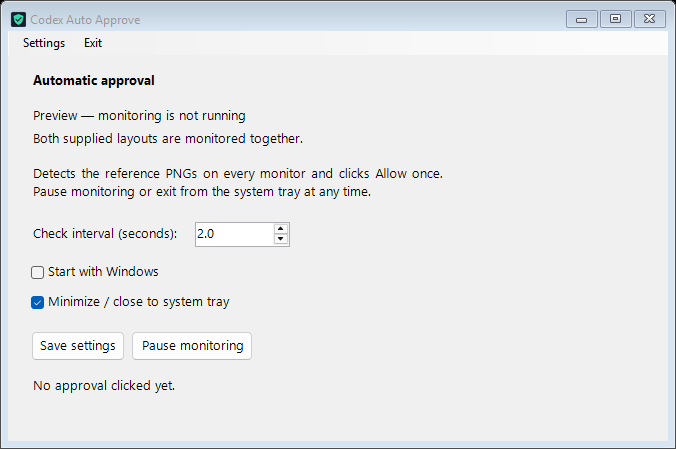

# Codex Auto Approve

**Remote sessions:** When Codex is started or restarted remotely, for example from a
phone, it keeps asking for permission. In this situation, the **Always approve** button
does not work.


A Windows tray application that monitors **all three supplied layouts simultaneously**:
`images/allow_once.png`, `images/allow_once_2.png`, and `images/allow_once_3.png`. When any complete reference
appears on a monitor, it clicks the **Allow once** part of that layout.



*Settings and the activity log (latest 100 entries) in preview mode; monitoring is disabled for this screenshot.*

## Run

Download the ZIP from [GitHub Releases](https://github.com/kurta999/CodexAutoApprove/releases),
extract it to a writable folder, and open `CodexAutoApprove.exe`. Keep `settings.ini` and
`images` alongside the executable. The complete Windows x64 package includes .NET;
Windows 10/11 is required. A local framework-dependent build additionally needs the
.NET 10 Desktop Runtime and its accompanying DLLs.

Monitoring begins immediately. With **Minimize to tray** enabled, minimizing or closing
the window keeps the app in the system tray. Disable it for normal taskbar minimizing
and exit on close. Use **Pause monitoring** to pause, or **Exit** to stop completely.
Only one instance runs per Windows session.

## Settings

Change the interval and **Start with Windows** checkbox, then select **Save settings**.
The **Settings → Start with Windows** menu also saves the startup choice immediately.
Startup is disabled by default. Enabling it registers this executable under the current
user's `HKCU\Software\Microsoft\Windows\CurrentVersion\Run` key, with no administrator
rights required. It starts in the system tray when that user signs in to Windows.
The **Minimize to tray** setting is available in the window and Settings menu.

You can also edit `settings.ini` next to the executable:

```ini
[General]
CheckIntervalSeconds=2
StartWithWindows=false
MinimizeToTray=true
```

Intervals accept decimals from 0.2 to 3600 seconds and are the delay after a scan
completes. The app reloads settings and PNG additions/changes during operation. An
invalid configuration blocks clicks and displays the error until corrected. Setting
`StartWithWindows=false` removes the startup entry while the app runs. If edited while
the app is closed, a stale startup entry is removed on the next launch; a background
launch exits without monitoring when this setting is false. Moving the app requires
opening the new copy once so the startup command can be updated.

## Matching and click locations

The app searches every monitor in physical pixels. It searches the configured scales
plus scales relative to the monitor's 1920×1080 reference resolution. Windows DPI
awareness and virtual-desktop coordinates support different display scaling and
monitors to the left or above the primary screen. Exact matching scale is independent
of the PNG's position, so no fixed on-screen approval coordinates are assumed.

These click offsets are relative to the original reference images:

| Reference | Click X | Click Y |
| --- | ---: | ---: |
| allow_once.png | 163 | 23 |
| allow_once_2.png | 155 | 55 |
| allow_once_3.png | 130 | 17 |

The click point scales with the detected reference size and remains away from Deny and
the dropdown arrow. A new screen capture verifies the match immediately before the
click. A shared cooldown (default 3 seconds) limits repeated clicks across all layouts.
Do not move the pointer during a click: the app moves the pointer to the approval button.

`Matching.MinimumScore` defaults to `0.90` (90%); higher values require closer visual matches.
`Matching.Scales` adds scales for other browser zoom/display sizes. The search checks
image appearance; changed themes or redesigned buttons require new reference images.
Normal Windows input restrictions apply to elevated windows and the secure desktop.

Add other reference PNGs to `images`. For a light approval button, the app can infer a
click point inside the largest light area. Set an explicit offset for any other layout:

```ini
[Template:my_reference.png]
ClickX=120
ClickY=30
```

Use tightly cropped reference images containing enough label detail to identify the
intended action. Adding a PNG activates it on the next configuration refresh. `activity.log`
records per-image scan scores, successful clicks, and errors, without saving screen captures.

The **Activity log** panel keeps the newest **100 entries**, removing the oldest as new
entries arrive. Each completed scan logs a timestamp, filename, match percentage, 90%
threshold, and result for every image. Scanning and logging continue during the click
cooldown. Pausing monitoring stops scans.

For an accepted match, the percentage is its fully verified image similarity. When no
match passes the click checks, the log shows the full-pixel similarity of the best
candidate from a faster, coarse diagnostic search. Such entries say **no verified match
(diagnostic candidate)** and cannot trigger clicks, even if their visual similarity is
above the threshold. If no configured reference scale fits a screen, the score is **N/A**.
Diagnostic searches may add time to scans with no accepted matches.

## Build and verify

No third-party packages are required. With the .NET 10 SDK:

```powershell
dotnet build -c Release
dotnet run --project tests/CodexAutoApprove.Tests.csproj -c Release -- C:\GIT_local\CodexAutoApprove
./scripts/Package.ps1 -Version local
```

The test executable uses synthetic frames constructed from the supplied PNGs. It tests
all three layouts, multiple scales, simultaneous visibility, negative monitor origins, click
offsets, unrelated images, and INI round trips. It performs no desktop capture, live
clicks, or startup registry changes. The UI preview test opens its own window briefly
with monitoring disabled, then saves `tests/.scratch/ui-preview.png`.

`scripts/Package.ps1` creates a complete portable ZIP and SHA-256 checksum under `publish`.
It includes the self-contained x64 application, all three reference PNGs, settings, and this
README with its images. Use `-FrameworkDependent` for a smaller build on a PC with .NET
10 Desktop Runtime. The icon can be regenerated with `scripts/Create-Icon.ps1`.

## GitHub CI/CD

The [build workflow](.github/workflows/build-release.yml) runs on pushes, pull requests,
and manual dispatches. It builds, tests all layouts and settings, packages the complete
Windows application, and uploads the ZIP/checksum as downloadable workflow artifacts.
Pushing a `v*` tag also creates a GitHub Release with that package after all checks pass:

```powershell
git tag v1.0.0
git push origin main
git push origin v1.0.0
```

The release job uses GitHub's built-in token with `contents: write`; no extra release
secret is needed. Builds on ordinary branches and pull requests have read-only access.
